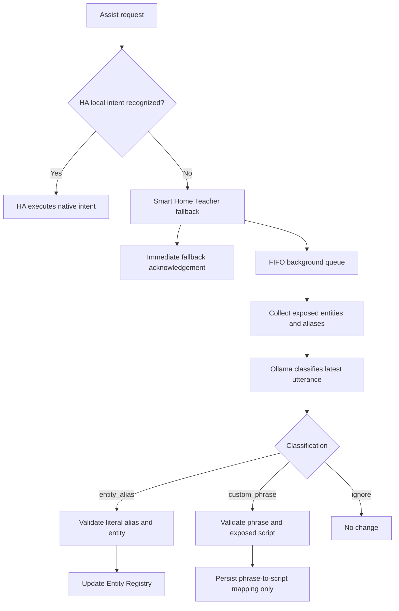

# Architecture

## Runtime components

| File | Responsibility |
|---|---|
| `manifest.json` | HA integration metadata, version and dependencies |
| `const.py` | Integration domain, Ollama URL/model and storage names |
| `config_flow.py` | Import-based Config Entry creation |
| `__init__.py` | Integration lifecycle and Conversation platform setup |
| `conversation.py` | Assist conversation agent, FIFO learning queue, entity discovery, Ollama classification and alias validation |
| `custom_actions.py` | Persistence of learned phrase → script mappings; no execution |
| `translations/*.json` | English and Russian setup translations |

## Request flow

## Safety boundary

Smart Home Teacher is training-only: it can update an entity alias or save a phrase-to-script record, but it never registers learned intents, generates executable Assist sentences, or calls device services. Learned phrase mappings are inert records; any later script execution must come from Home Assistant's own native handling, not this integration.

The model receives entity identifiers, domains, names and aliases for exposed entities. It does not receive device state from the entity discovery function. The candidate list is capped at 64 entries and sorted by lexical overlap with the request.

## Known design limitation

The current alias validator proves that the alias is a short literal fragment of the utterance and that the selected entity was among the exposed candidates. It does not prove that the selected entity is semantically the device named by the user. There is no deterministic domain/device-class compatibility check and no minimum model confidence field in the response schema. For ambiguous or incorrect mappings, the model can therefore associate a valid alias with the wrong exposed entity. This is a key area for a future validator/orchestrator improvement.
