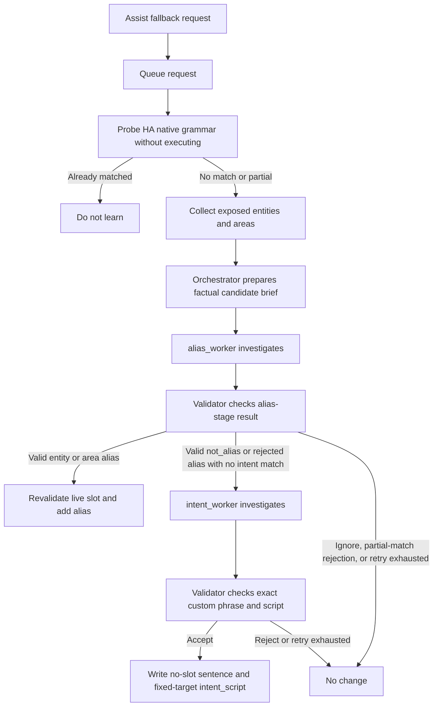

# Architecture

## Runtime components

| File | Responsibility |
|---|---|
| `manifest.json` | HA integration metadata, version and dependencies |
| `const.py` | Integration domain, Ollama URL/model and storage names |
| `config_flow.py` | Import-based Config Entry creation |
| `__init__.py` | Integration lifecycle and Conversation platform setup |
| `conversation.py` | Assist queue, non-executing native-grammar probe, deterministic alias-first orchestration and persistence validation |
| `custom_actions.py` | Persistence of learned phrase → script mappings and generation of native HA custom sentences / `intent_script` entries |
| `prompts/*.txt` | English and Russian orchestrator, alias-worker, intent-worker and validator prompts |
| `translations/*.json` | English and Russian setup translations |

## Request flow

## Safety and routing

Smart Home Teacher never calls a device or script service while learning. The
initial probe uses Home Assistant's non-executing native grammar recognizer.
An existing match is not taught again. A partial grammar match is an alias
candidate only when exactly one unmatched slot is named `name` or `area`.
Python requires the proposed alias to equal the unmatched slot text, occur
literally in the latest utterance, avoid existing names/aliases, and refer to
one exposed target. The integration re-probes after writing the alias and
rolls it back unless the same native intent now matches.

Only a validator-approved `not_alias` or a rejected alias proposal can reach
`intent_worker`, and only when HA reports `no_intent_match`. A rejected alias
is never persisted. The intent worker may propose the entire latest utterance,
unchanged, for one clearly supported exposed `script.*`. The validator checks
the exact phrase, script target, request history and grammar evidence. Saved
phrases become no-slot native intents bound to the script; HA may run the
script on a future matching request.

The flow does not use a hard-coded or inferred standard-verb list. It does not
strip words such as command verbs from candidate aliases: HA's unmatched slot
is authoritative. If the non-executing recognizer is unavailable, processing
fails closed.

The managed `intent_script` block is added to `configuration.yaml`; existing
mapping-style entries are retained. If the file uses an include or inline
`intent_script` value that cannot be safely merged, activation fails explicitly
and leaves that section untouched. Generated custom sentences are written to
the marked integration-owned file
`custom_sentences/<language>/smart_home_teacher_native.yaml`; an existing
unmarked file is never overwritten.

After a result is successfully saved, the integration fires the
`smart_home_teacher_learning_result` event. An automation can filter that event
and call `smart_home_teacher.cleanup_learning_result` with its exact fields to
remove the learned alias or phrase. Phrase cleanup also removes only the
integration-managed intent and sentence artifacts for that mapping; no script
or device service is called.

## Model roles and validation

The orchestrator prepares candidate hints and a brief but does not choose a
classification. `alias_worker` investigates alias opportunities.
`intent_worker` runs after alias analysis is validated as `not_alias` or an
alias proposal is rejected when there is no native intent match.
The validator independently checks each stage. Deterministic Python validation
is authoritative for grammar gating, target membership, alias-slot equality,
collisions, exact phrase text and exposed-script domain. Each stage permits
one feedback retry, then fails closed.

All model calls use Ollama structured outputs, temperature 0, and `think:
false` for the configured Qwen3 model. Alias learning normally uses three
model calls (orchestrator, alias worker, validator); intent learning normally
uses five (plus intent worker and its validator). A retry adds two calls. The
candidate list is capped at 64 entries and sorted by lexical overlap with the
request. Prompt and entity data are treated as untrusted input. The validator
does not receive live device state, so semantic judgments remain bounded by
the utterance, recent history and entity metadata.
